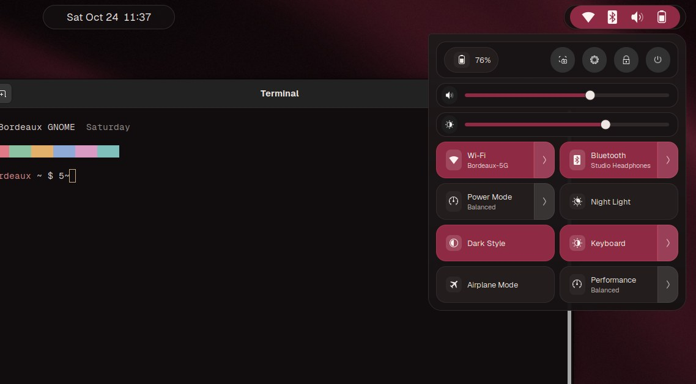
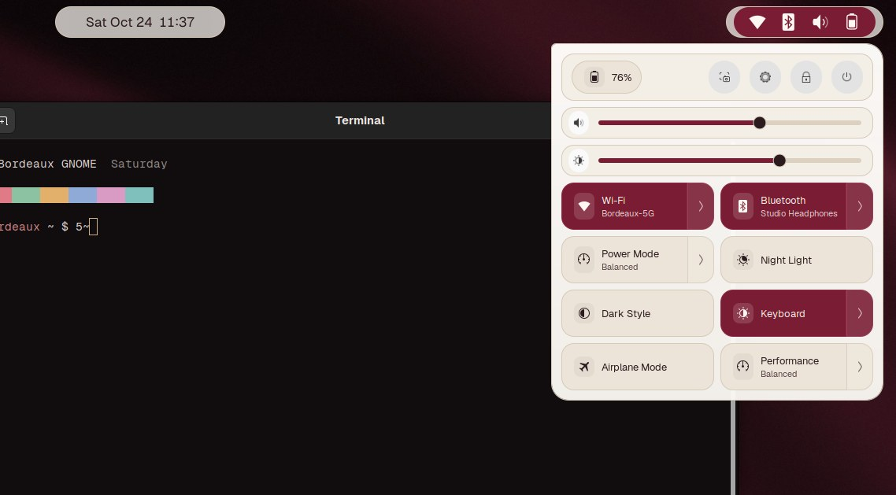

# Bordeaux GNOME

[](https://github.com/hamza-gouda1/bordeaux-gnome/actions/workflows/check.yml)


A burgundy theme family for the GNOME desktop: two dark variants and one
light one, styled from the top bar down to the boot screen. The 210 declared
contrast pairs meet their text or non-text thresholds, and CI checks them on
every change; translucent runtime surfaces still need visual review.


| Quick Settings | Calendar and notifications | Overview |
|---|---|---|
|  |  |  |
|  |  |  |
|  |  |  |

All screenshots are rendered by `tools/shell_qa.py` in a headless GNOME Shell 46
with made-up networks, devices and notifications; more in
[`screenshots/`](screenshots/README.md).

Design previews of the dark and light schemes (rendered from the design tokens):

| Dark | Light |
|---|---|
|  |  |

## The palette


| Variant | Mode | Accent | Character |
|---|---|---|---|
| **Bordeaux** | dark | `#8E2A44` | wine-black surfaces, champagne-gold hairlines |
| **Oxblood Noir** | dark | `#A3283A` | near-black neutrals, a sharper red |
| **Merlot Day** | light | `#7A1C34` | warm paper whites, deep merlot accents |

## What it styles

- **GNOME Shell:** top bar, Activities overview, app grid, dock (Ubuntu Dock /
  Dash to Dock), Quick Settings, calendar and notifications, popup menus,
  search.
- **GTK 4 / Libadwaita and GTK 3 apps:** accent and status colors. Yaru supplies
  the surfaces and widget shapes, which follow the desktop light/dark preference live.
- **Boot (optional):** a GRUB menu theme and a Plymouth splash.

The GTK accent colors sit on top of Ubuntu's Yaru theme. Applications read the
user color file at startup, so restart them after changing the accent. Typography is set for
[Geist](https://vercel.com/font) and falls back to your system font.

## Install

Requirements: GNOME 46 (tested on Ubuntu 24.04), the **User Themes**
extension (`sudo apt install gnome-shell-extensions`), and the Yaru theme
(preinstalled on Ubuntu).

```bash
git clone https://github.com/hamza-gouda1/bordeaux-gnome.git
cd bordeaux-gnome
./install.sh --dry-run          # see what would change
./install.sh                    # Bordeaux
./install.sh --variant oxblood-noir
./install.sh --variant merlot-day
```

The first install saves your current GNOME settings and any existing
`gtk.css`. Switching variants later keeps that first backup. To go back to
exactly how things were:

```bash
./uninstall.sh
```

Restart open apps to see the GTK colors; the Shell theme changes at once.

### Desktop preset and Terminal profile

By default the installer also applies a per-variant preset from
`presets/<Variant>.preset`: Geist 11 and Geist Mono as interface fonts,
Ubuntu Dock on the left as a floating slab with 48px icons, set to intellihide
(it slides away when a window overlaps it and returns when the pointer touches
the screen edge, so apps get the full width), Blur my Shell (the lock screen
and app folders get Bordeaux pipelines and the overview a brightness-only
pipeline, blur radius 0; panel, dock and popup blur are off to keep Super
smooth) and Just Perfection (animation 4 = 0.6× duration, 56px bar). To keep the dock always visible:
`gsettings set org.gnome.shell.extensions.dash-to-dock dock-fixed true`. Keys whose
schema is not installed are skipped. It also adds a GNOME Terminal profile
from `terminal/<Variant>.dconf` (the variant's ANSI palette), which is not
made the default unless you ask.

```bash
./install.sh --no-preset           # colors and Shell theme only
./install.sh --icons --cursor      # recommended icon/cursor theme, only if already installed
./install.sh --terminal-default    # make the Bordeaux profile the default
./install.sh --wallpaper           # also set the variant's wallpaper
```

Every changed key is saved to `~/.local/state/bordeaux-gnome/backup/preset.txt`
first (keys that were at their default are noted as such), and
`./uninstall.sh` puts each one back or resets it. Both folders are generated
by `tools/build.py` from `tokens/tokens.toml`.

### Light and dark: following the Dark Style switch

By default the desktop follows **Dark Style** in Quick Settings
(`org.gnome.desktop.interface color-scheme`): Merlot Day when it is off,
Bordeaux (or Oxblood Noir, if you installed with `--variant oxblood-noir`)
when it is on. `--variant` only picks what is shown right after installing.

- **Wallpaper** (with `--wallpaper`): `picture-uri` is Merlot Day and
  `picture-uri-dark` the dark variant's, so GNOME swaps them itself.
- **Shell, GTK theme, preset keys, Terminal, GTK colours**: the installer adds
  the `bordeaux-aura@hamza-gouda` extension (the dock glow, now also the
  theme companion) and turns on its `follow-color-scheme`. On each change,
  debounced by 250 ms, it sets the User Themes name, `gtk-theme`
  (Yaru / Yaru-dark), the preset keys that differ between variants (Blur my
  Shell pipelines, lock screen pipeline, aura accent, and icon/cursor themes
  while they are ours), the dark wallpaper, the GNOME Terminal default profile
  (only when the default is already one of the Bordeaux profiles; both the
  light and the dark profile are installed) and `~/.config/gtk-{3,4}.0/gtk.css`
  (only while it is an unedited Bordeaux copy). Each value is changed only
  when it is still one Bordeaux set, so anything you chose yourself stays. The
  data comes from `extensions/bordeaux-aura@hamza-gouda/variants/<Variant>.json`,
  written by `tools/build.py`. Pick the dark variant or turn following off in
  the extension's settings.
- **GTK apps**: GTK 3, GTK 4.14 and libadwaita 1.5 read only
  `~/.config/gtk-N.0/gtk.css`, once when an app starts (a `gtk-dark.css` there
  is never loaded; checked in the libraries on Ubuntu 24.04). So libadwaita
  apps switch their own light/dark at once, and pick up the Bordeaux or
  Merlot Day colours the next time they start.

`./install.sh --static` keeps the old behaviour: one variant everywhere, no
extension. `./uninstall.sh` resets the extension's keys, removes it (unless
you had installed it yourself before) and restores the rest as before.

| Dark Style on | Dark Style off |
|---|---|
|  |  |

### App shortcuts that raise the open window (Focus Keys)

A custom shortcut that runs `gtk-launch` or a launcher cannot bring an
already-open app to the front on Wayland: GNOME shows "*App* is ready"
instead. The installer adds the small `focus-keys@hamza-gouda` extension,
which does it from the shell: the app's most recent window comes to the front
(switching workspace if needed), a second press cycles its windows, and an app
that is not running is started. It gets one shortcut, **Ctrl+F9 → Spotify**
(`spotify.desktop`), merged with any you already have; a key that a GNOME
custom shortcut already uses is skipped with a note. It starts after you log
out and back in. Add more in the Extensions app (Focus Keys > Settings).
`./install.sh --no-shortcuts` leaves it out; `./uninstall.sh` removes only the
shortcuts and the enable it added. Details in its
[README](extensions/focus-keys@hamza-gouda/README.md).

### Boot screen (optional, needs root)

```bash
sudo ./install-boot.sh --dry-run     # preview
sudo ./install-boot.sh               # GRUB menu + Plymouth splash
sudo ./install-boot.sh --only grub
sudo ./install-boot.sh --variant oxblood-noir   # GRUB image per variant (Merlot Day has none)
sudo ./install-boot.sh --remove      # undo
```

The wallpapers and GRUB images in `wallpapers/` are original, generated by
`tools/make_wallpapers.py`.

GRUB is set through `/etc/default/grub.d/90-bordeaux-gnome.cfg`, so your
`/etc/default/grub` is never edited.

### Dock aura (extension)

`extensions/bordeaux-aura@hamza-gouda` adds a faint glow in each app's own
colour behind the Ubuntu Dock icons, pulled slightly toward the theme
accent. The icons themselves are left untouched. `install.sh` installs and
enables it (it also does the light/dark following above); with `--static` it
is left out. It starts after you log out and back in.

Settings (intensity, only on hover, accent, light/dark following) are in the Extensions app. See
the extension's [README](extensions/bordeaux-aura@hamza-gouda/README.md).

## How it's checked

```bash
python3 tools/check_contrast.py   # WCAG 2.1 contrast of every color pair
bash tests/test_install.sh        # install, switch, uninstall in a throwaway home
gjs -m tests/test_aura_colour.js  # dock aura colour maths
gjs -m tests/test_focus_keys.js   # Focus Keys parsing, window choice, lifecycle
gjs -m tests/test_theme_follow.js # light/dark following: mapping, debounce, settings
python3 tests/test_follow_json.py # the per-variant JSON matches the presets
python3 tests/test_shell_css.py   # shell sheet regressions found in real renders
python3 tools/shell_qa.py --variant all --out /tmp/qa   # visual QA, see below
```

`check_contrast.py` checks the pairs declared in `tokens/tokens.toml`
against each variant's palette there, and CI's `tools/build.py --check`
keeps the shipped CSS identical to those tokens. Translucent colors are
blended over their background first. All 210 checked pairs (70 per variant)
pass their minimum: 154 reach AAA (7:1), 52 pass AA (4.5:1), and 4
UI-component pairs (focus ring, gold hairline, dimmed overview labels) are
held to the 3.0 non-text minimum. The install test runs
with an in-memory settings backend, so it never touches the desktop it runs
on. CI also runs shellcheck on every script.

`tools/make_palette.py` redraws `docs/palette.svg` from the CSS.

### Visual QA in a real shell

`tools/shell_qa.py` renders every surface in a real GNOME Shell 46 started with
`--headless`, one variant at a time: desktop with the dock, dock hover and
menu, Quick Settings and each of its menus (Wi-Fi, Bluetooth, Power Mode, TUF
Performance, power), notifications and the calendar, OSDs, the overview, search,
app grid and folders, Alt-Tab, the workspace switcher, the run and power-off
dialogs and the lock screen. It saves a PNG per scene and checks the top-bar
font size (15px or more), equal dock slab margins, centred dock icons and
labels the shell had to cut with an ellipsis.

Three scenes check behaviour rather than looks. `color-scheme` flips Dark
Style and expects the shell stylesheet, User Themes name, GTK theme, aura
accent and both GTK stylesheets to switch Bordeaux → Merlot Day → Oxblood Noir
(dark variant changed) and back, with three quick toggles giving one switch. `focus-keys` presses real key
combinations on a virtual keyboard: Ctrl+F9 must bring Calculator from the
second workspace to the front, a shortcut for an app that is not running must
start it with the focus and no "is ready" notification, a missing app must give
an OSD, the extension must release every key on disable and take them back on
enable, and its preferences window must open. `profile-osd` switches the mock
asusd profile three times in quick succession (as Fn+F5 does) and expects one
"Performance" OSD from the TUF Control extension, then a "Quiet" one
([screenshot](screenshots/bordeaux-osd-profile.png)).

Nothing reaches your session: the shell gets its own HOME, a keyfile settings
backend, a private session bus and a private *system* bus on which
`tools/qa/mockbus.js` plays logind, NetworkManager, BlueZ, UPower,
power-profiles-daemon, asusd and GDM with fake devices. The whole run sits in a
`systemd-run --user --scope` with `MemoryMax=1500M` and no swap, under a
timeout, and the scope is stopped afterwards. `--publish screenshots` rewrites
the images in this repo.

```bash
python3 tools/shell_qa.py --variant Merlot-Day --scene desktop,quick-settings --out /tmp/qa
```

The lock screen is not themed: GNOME turns extensions off while locked, User
Themes included, so it shows Yaru with the blur-my-shell lock blur.

## Limitations

- Restart GTK apps once after installation so they load the accent stylesheet.
  Surface colours then follow the Dark Style preference where the application
  supports it; changing the custom accent still requires restarting GTK apps.
- The lock screen cannot be themed: GNOME turns extensions off while locked,
  User Themes included, so it shows Yaru (with the blur-my-shell lock blur).
- Built for a Wayland GNOME 46 session on Ubuntu 24.04; X11 sessions are
  untested.
- Tested on one machine.
- Electron apps, including desktop chat clients and VS Code-based editors, use their
  own application theme setting; the user GTK accent file does not control them.

## Layout

```
themes/<Variant>/gnome-shell/gnome-shell.css   Shell theme
themes/<Variant>/gtk-3.0/gtk.css                GTK 3 colors
themes/<Variant>/gtk-4.0/gtk.css                GTK 4 / Libadwaita colors
presets/<Variant>.preset                        dock, blur, font keys
terminal/<Variant>.dconf                        GNOME Terminal profile
boot/grub/bordeaux/                             GRUB menu theme
boot/plymouth/bordeaux/                         Plymouth splash
extensions/bordeaux-aura@hamza-gouda/           dock aura extension
extensions/focus-keys@hamza-gouda/              raise-or-launch app shortcuts
install.sh  uninstall.sh  install-boot.sh
tools/  tests/  docs/  screenshots/
```

## License

GPL-3.0-or-later. See [`LICENSE`](LICENSE).

### Native touchpad gestures and Show desktop

GNOME Shell 46 retains its three-finger overview and workspace swipe trackers and
native easing. Just Perfection's animation value 4 uses 0.6× normal duration;
higher values are not uniformly faster. This short settling animation avoids
extra frame callbacks and is suitable for evaluation on a 165 Hz display.
Physical touchpad feel still needs a live-session check.

Focus Keys provides an optional **Show desktop** shortcut in its preferences;
it is unbound by default. It fades eligible windows on the active workspace
with a short stagger, minimises them, and restores exactly those windows on the
next press. Previously minimised windows stay minimised. Interrupted fades and
extension disable restore opacity and surviving windows; reduced-motion settings
are respected. The headless harness calls the action directly for verification.

A downward-only touchpad consumer cannot reliably arbitrate BEGIN/UPDATE with
GNOME 46's captured-event swipe trackers without replacing private tracker
internals. This theme therefore ships the keybinding fallback and leaves the
native three-finger gestures with GNOME. Experimental gestures from other
extensions must be evaluated independently in a real session.

The optional boot installer snapshots replaced GRUB/Plymouth assets and the
Plymouth selection under `/var/lib/bordeaux-gnome/boot-backup`; `--remove` restores
the saved assets. Its privileged operations and actual boot result have not been
exercised in this audit; only dry-run and isolated restore logic were checked.
