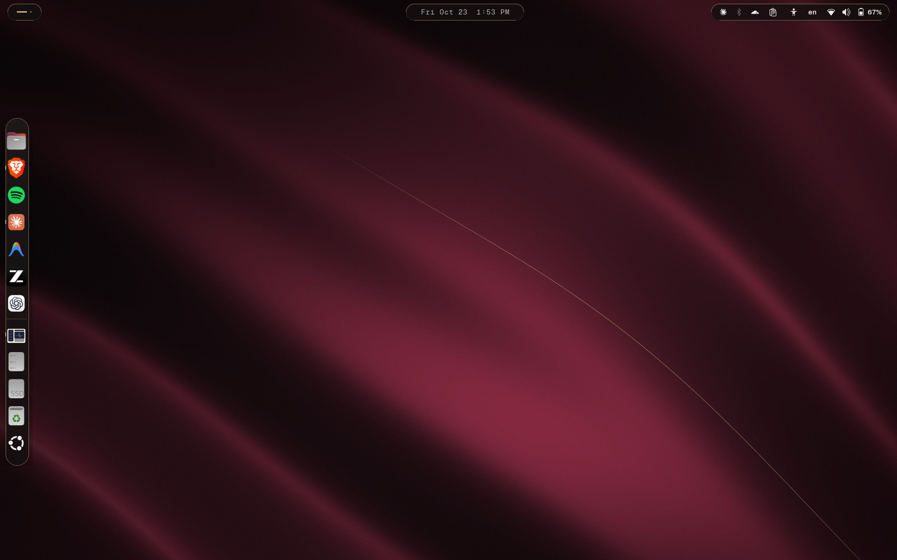

# Bordeaux GNOME

[](https://github.com/hamza-gouda1/bordeaux-gnome/actions/workflows/check.yml)


A burgundy theme family for the GNOME desktop: two dark variants and one
light one, styled from the top bar down to the boot screen. Every text and
background color pair passes WCAG AA contrast, and CI checks it on every
change.



| Oxblood Noir | Merlot Day |
|---|---|
|  |  |

## The palette


| Variant | Mode | Accent | Character |
|---|---|---|---|
| **Bordeaux** | dark | `#9B1F40` | wine-black surfaces, champagne-gold hairlines |
| **Oxblood Noir** | dark | `#A3283A` | near-black neutrals, a sharper red |
| **Merlot Day** | light | `#7A1C34` | warm paper whites, deep merlot accents |

## What it styles

- **GNOME Shell:** top bar, Activities overview, app grid, dock (Ubuntu Dock /
  Dash to Dock), Quick Settings, calendar and notifications, popup menus,
  search.
- **GTK 4 / Libadwaita and GTK 3 apps:** window, view, header bar, sidebar,
  card, popover and dialog colors, plus the accent.
- **Boot (optional):** a GRUB menu theme and a Plymouth splash.

The GTK colors sit on top of Ubuntu's Yaru theme, so widgets keep Yaru's
shapes and only the colors change. Typography is set for
[Geist](https://vercel.com/font) and falls back to your system font.

## Install

Requirements: GNOME 46 (tested on Ubuntu 24.04), the **User Themes**
extension (`sudo apt install gnome-shell-extensions`), and the Yaru theme
(preinstalled on Ubuntu).

```bash
git clone https://github.com/hamza-gouda1/bordeaux-gnome.git
cd bordeaux-gnome
./install.sh --dry-run          # see what would change
./install.sh                    # Bordeaux
./install.sh --variant oxblood-noir
./install.sh --variant merlot-day
```

The first install saves your current GNOME settings and any existing
`gtk.css`. Switching variants later keeps that first backup. To go back to
exactly how things were:

```bash
./uninstall.sh
```

Restart open apps to see the GTK colors; the Shell theme changes at once.

### Boot screen (optional, needs root)

```bash
sudo ./install-boot.sh --dry-run     # preview
sudo ./install-boot.sh               # GRUB menu + Plymouth splash
sudo ./install-boot.sh --only grub
sudo ./install-boot.sh --remove      # undo
```

GRUB is set through `/etc/default/grub.d/90-bordeaux-gnome.cfg`, so your
`/etc/default/grub` is never edited.

## How it's checked

```bash
python3 tools/check_contrast.py   # WCAG 2.1 contrast of every color pair
bash tests/test_install.sh        # install, switch, uninstall in a throwaway home
```

`check_contrast.py` reads the `@define-color` values straight from each
variant's CSS, so it always tests the colors that ship rather than a separate
list. Translucent colors are blended over their background first. All 33
theme pairs pass AA (4.5:1), and most pass AAA (7:1). The install test runs
with an in-memory settings backend, so it never touches the desktop it runs
on. CI also runs shellcheck on every script.

`tools/make_palette.py` redraws `docs/palette.svg` from the CSS.

## Layout

```
themes/<Variant>/gnome-shell/gnome-shell.css   Shell theme
themes/<Variant>/gtk-3.0/gtk.css                GTK 3 colors
themes/<Variant>/gtk-4.0/gtk.css                GTK 4 / Libadwaita colors
boot/grub/bordeaux/                             GRUB menu theme
boot/plymouth/bordeaux/                         Plymouth splash
install.sh  uninstall.sh  install-boot.sh
tools/  tests/  docs/  screenshots/
```

## License

GPL-3.0-or-later. See [`LICENSE`](LICENSE).
