# Bordeaux GNOME

[](https://github.com/hamza-gouda1/bordeaux-gnome/actions/workflows/check.yml)


A burgundy theme family for the GNOME desktop: two dark variants and one
light one, styled from the top bar down to the boot screen. Every text and
background color pair passes WCAG AA contrast, and CI checks it on every
change.

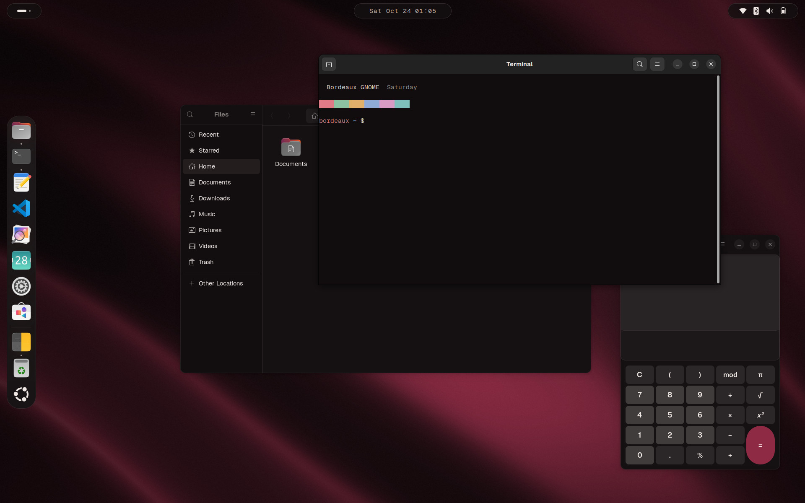

| Quick Settings | Calendar and notifications | Overview |
|---|---|---|
| 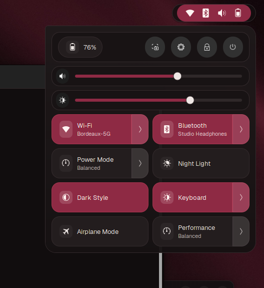 | 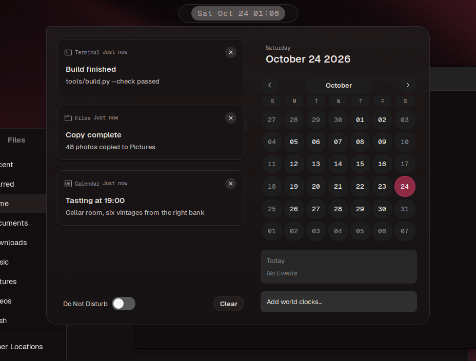 | 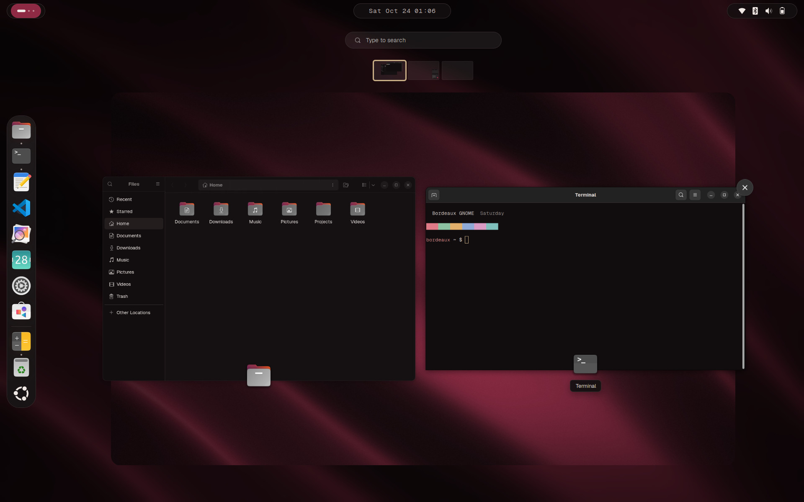 |
| 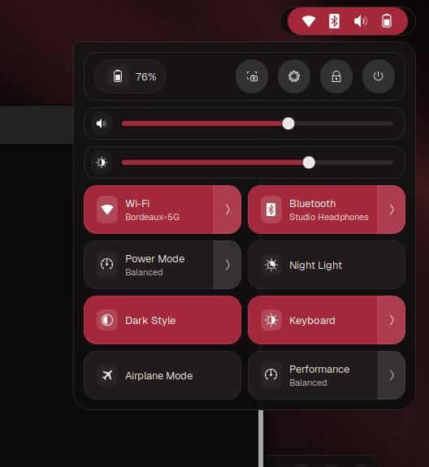 | 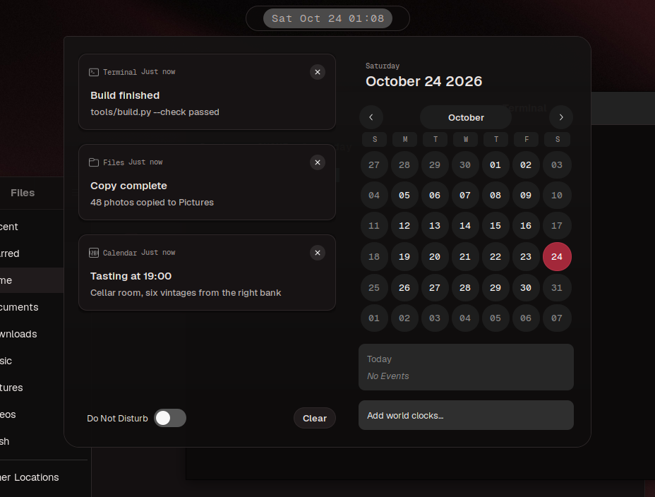 | 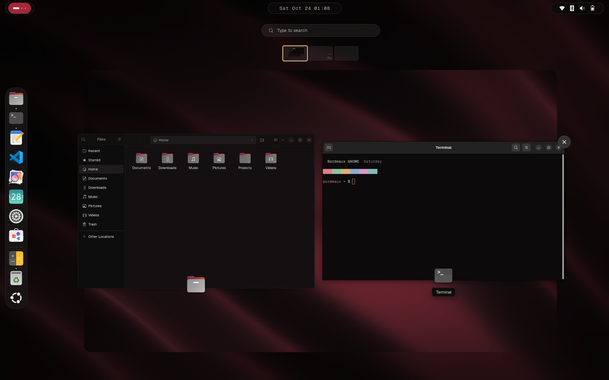 |
| 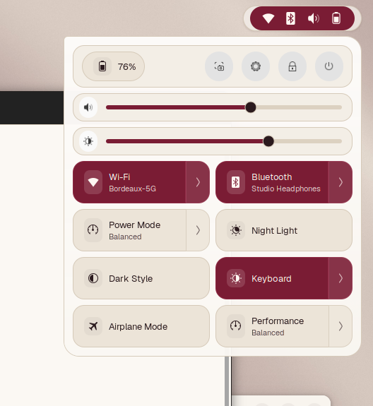 | 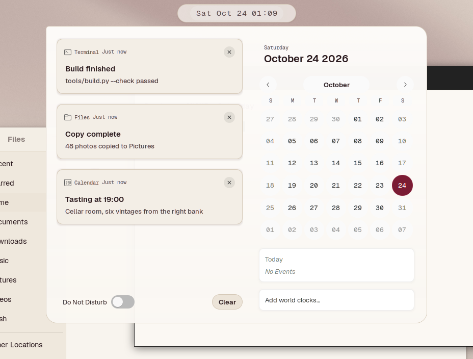 | 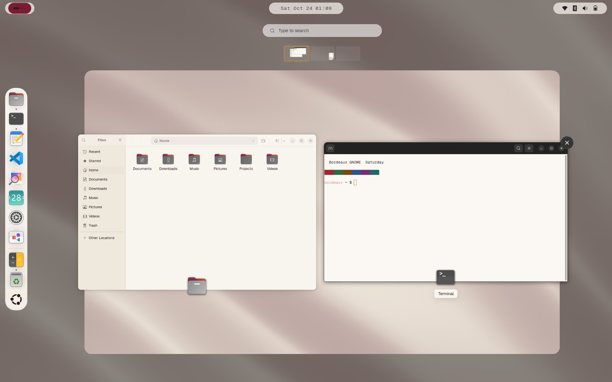 |

All screenshots are rendered by `tools/shell_qa.py` in a headless GNOME Shell 46
with made-up networks, devices and notifications; more in
[`screenshots/`](screenshots/README.md).

Design previews of the dark and light schemes (rendered from the design tokens):

| Dark | Light |
|---|---|
| 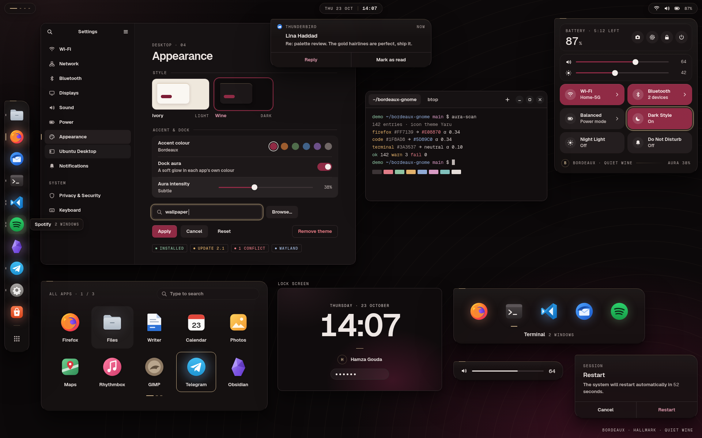 | 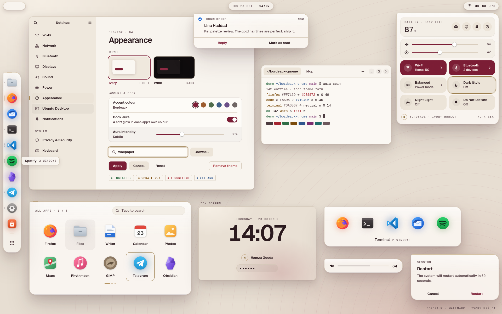 |

## The palette

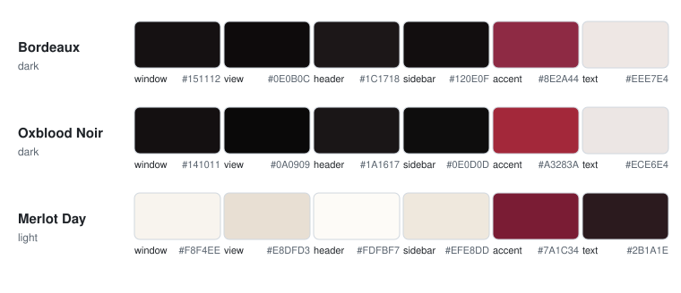

| Variant | Mode | Accent | Character |
|---|---|---|---|
| **Bordeaux** | dark | `#9B1F40` | wine-black surfaces, champagne-gold hairlines |
| **Oxblood Noir** | dark | `#A3283A` | near-black neutrals, a sharper red |
| **Merlot Day** | light | `#7A1C34` | warm paper whites, deep merlot accents |

## What it styles

- **GNOME Shell:** top bar, Activities overview, app grid, dock (Ubuntu Dock /
  Dash to Dock), Quick Settings, calendar and notifications, popup menus,
  search.
- **GTK 4 / Libadwaita and GTK 3 apps:** window, view, header bar, sidebar,
  card, popover and dialog colors, plus the accent.
- **Boot (optional):** a GRUB menu theme and a Plymouth splash.

The GTK colors sit on top of Ubuntu's Yaru theme, so widgets keep Yaru's
shapes and only the colors change. Typography is set for
[Geist](https://vercel.com/font) and falls back to your system font.

## Install

Requirements: GNOME 46 (tested on Ubuntu 24.04), the **User Themes**
extension (`sudo apt install gnome-shell-extensions`), and the Yaru theme
(preinstalled on Ubuntu).

```bash
git clone https://github.com/hamza-gouda1/bordeaux-gnome.git
cd bordeaux-gnome
./install.sh --dry-run          # see what would change
./install.sh                    # Bordeaux
./install.sh --variant oxblood-noir
./install.sh --variant merlot-day
```

The first install saves your current GNOME settings and any existing
`gtk.css`. Switching variants later keeps that first backup. To go back to
exactly how things were:

```bash
./uninstall.sh
```

Restart open apps to see the GTK colors; the Shell theme changes at once.

### Desktop preset and Terminal profile

By default the installer also applies a per-variant preset from
`presets/<Variant>.preset`: Geist 11 and Geist Mono as interface fonts,
Ubuntu Dock on the left as a floating slab with 48px icons, set to intellihide
(it slides away when a window overlaps it and returns when the pointer touches
the screen edge, so apps get the full width), Blur my Shell (only lock screen
and popups; panel, dock and overview blur are off to keep Super smooth) and
Just Perfection (animation speed 4, 46px bar). To keep the dock always visible:
`gsettings set org.gnome.shell.extensions.dash-to-dock dock-fixed true`. Keys whose
schema is not installed are skipped. It also adds a GNOME Terminal profile
from `terminal/<Variant>.dconf` (the variant's ANSI palette), which is not
made the default unless you ask.

```bash
./install.sh --no-preset           # colors and Shell theme only
./install.sh --icons --cursor      # recommended icon/cursor theme, only if already installed
./install.sh --terminal-default    # make the Bordeaux profile the default
./install.sh --wallpaper           # also set the variant's wallpaper
```

Every changed key is saved to `~/.local/state/bordeaux-gnome/backup/preset.txt`
first (keys that were at their default are noted as such), and
`./uninstall.sh` puts each one back or resets it. Both folders are generated
by `tools/build.py` from `tokens/tokens.toml`.

### Boot screen (optional, needs root)

```bash
sudo ./install-boot.sh --dry-run     # preview
sudo ./install-boot.sh               # GRUB menu + Plymouth splash
sudo ./install-boot.sh --only grub
sudo ./install-boot.sh --variant oxblood-noir   # GRUB image per variant (Merlot Day has none)
sudo ./install-boot.sh --remove      # undo
```

The wallpapers and GRUB images in `wallpapers/` are original, generated by
`tools/make_wallpapers.py`.

GRUB is set through `/etc/default/grub.d/90-bordeaux-gnome.cfg`, so your
`/etc/default/grub` is never edited.

### Dock aura (optional extension)

`extensions/bordeaux-aura@hamza-gouda` adds a faint glow in each app's own
colour behind the Ubuntu Dock icons, pulled slightly toward the theme
accent. The icons themselves are left untouched. It is not installed by
`install.sh` yet:

```bash
dest=~/.local/share/gnome-shell/extensions/bordeaux-aura@hamza-gouda
mkdir -p "$dest" && cp -r extensions/bordeaux-aura@hamza-gouda/. "$dest"
glib-compile-schemas "$dest/schemas"
# On Wayland, log out and back in, then:
gnome-extensions enable bordeaux-aura@hamza-gouda
```

Settings (intensity, only on hover, accent) are in the Extensions app. See
the extension's [README](extensions/bordeaux-aura@hamza-gouda/README.md).

## How it's checked

```bash
python3 tools/check_contrast.py   # WCAG 2.1 contrast of every color pair
bash tests/test_install.sh        # install, switch, uninstall in a throwaway home
gjs -m tests/test_aura_colour.js  # dock aura colour maths
python3 tests/test_shell_css.py   # shell sheet regressions found in real renders
python3 tools/shell_qa.py --variant all --out /tmp/qa   # visual QA, see below
```

`check_contrast.py` reads the `@define-color` values straight from each
variant's CSS, so it always tests the colors that ship rather than a separate
list. Translucent colors are blended over their background first. All 33
theme pairs pass AA (4.5:1), and most pass AAA (7:1). The install test runs
with an in-memory settings backend, so it never touches the desktop it runs
on. CI also runs shellcheck on every script.

`tools/make_palette.py` redraws `docs/palette.svg` from the CSS.

### Visual QA in a real shell

`tools/shell_qa.py` renders every surface in a real GNOME Shell 46 started with
`--headless`, one variant at a time: desktop with the dock, dock hover and
menu, Quick Settings and each of its menus (Wi-Fi, Bluetooth, Power Mode, TUF
Performance, power), notifications and the calendar, OSDs, the overview, search,
app grid and folders, Alt-Tab, the workspace switcher, the run and power-off
dialogs and the lock screen. It saves a PNG per scene and checks the top-bar
font size (15px or more), equal dock slab margins, centred dock icons and
labels the shell had to cut with an ellipsis.

Nothing reaches your session: the shell gets its own HOME, a keyfile settings
backend, a private session bus and a private *system* bus on which
`tools/qa/mockbus.js` plays logind, NetworkManager, BlueZ, UPower,
power-profiles-daemon, asusd and GDM with fake devices. The whole run sits in a
`systemd-run --user --scope` with `MemoryMax=2000M` and no swap, under a
timeout, and the scope is stopped afterwards. `--publish screenshots` rewrites
the images in this repo.

```bash
python3 tools/shell_qa.py --variant Merlot-Day --scene desktop,quick-settings --out /tmp/qa
```

The lock screen is not themed: GNOME turns extensions off while locked, User
Themes included, so it shows Yaru with the blur-my-shell lock blur.

## Layout

```
themes/<Variant>/gnome-shell/gnome-shell.css   Shell theme
themes/<Variant>/gtk-3.0/gtk.css                GTK 3 colors
themes/<Variant>/gtk-4.0/gtk.css                GTK 4 / Libadwaita colors
presets/<Variant>.preset                        dock, blur, font keys
terminal/<Variant>.dconf                        GNOME Terminal profile
boot/grub/bordeaux/                             GRUB menu theme
boot/plymouth/bordeaux/                         Plymouth splash
extensions/bordeaux-aura@hamza-gouda/           dock aura extension
install.sh  uninstall.sh  install-boot.sh
tools/  tests/  docs/  screenshots/
```

## License

GPL-3.0-or-later. See [`LICENSE`](LICENSE).
